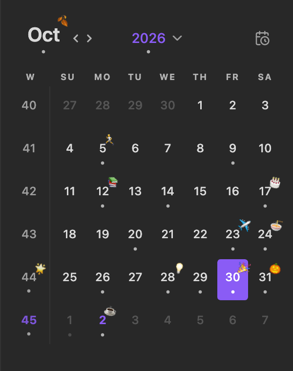
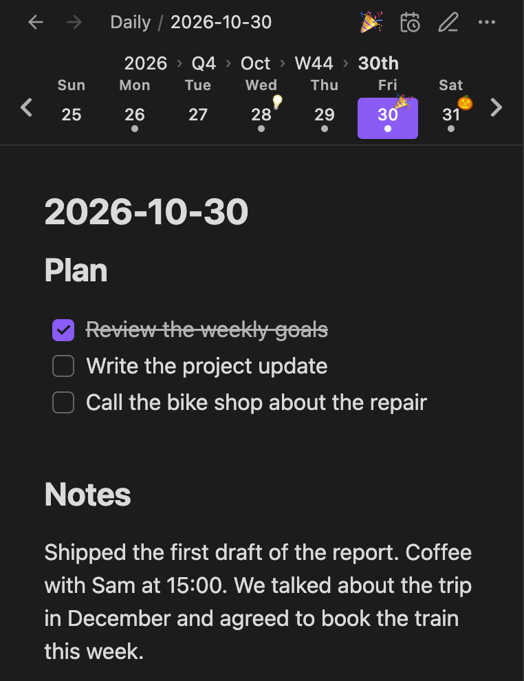

> [!NOTE]
> **Calendared** is a modified version of [luiisca/obsidian-periodic-notes-calendar](https://github.com/luiisca/obsidian-periodic-notes-calendar) v1.2.1
> by Luis Cadillo, changed since 2026-10-28 (GPL-3.0, same as the original). It is not maintained by the original author.
> What changed: [docs/customizations.md](docs/customizations.md) (Japanese).
>
> 日本語の使い方: [docs/guides/usage-ja.md](docs/guides/usage-ja.md)。開発向けの文書の目次: [docs/README.md](docs/README.md)。

# Calendared

Keep your days, weeks, months, quarters, and years calendared. Calendared creates and opens periodic notes
(daily, weekly, monthly, quarterly, and yearly notes) from a calendar, from breadcrumbs and a mini calendar above
each note, and from commands. Mark any periodic note with an emoji sticker and see it on the calendar.

Works on desktop and mobile. Needs Obsidian 1.13.1 or later.

<!-- Screenshots: put the images in docs/screenshots/ (see docs/screenshots/README.md), then uncomment.


-->

## Features

- **Periodic notes**: Turn each period (day, week, month, quarter, year) on or off on its own. Each period has
  one file name format, a folder, and a template. Only notes in the period's folder (or a folder inside it) count as
  its notes; a note with the same name elsewhere is an ordinary note.
- **Calendar**: A month calendar in the sidebar. Click a date, a week number, the month, or the year to open its note
  (or create it). Dots show which notes exist, and stickers show on top.
- **Breadcrumbs and mini calendar**: A strip above every note. The breadcrumbs (`2026 › Q4 › Oct › W44 › 30th`) open the
  note of the larger periods. The mini calendar shows the notes just before and after in the same period.
- **Open now**: One button that opens the current note of your finest period (today's note, if you use daily notes).
- **Stickers**: Give a periodic note one emoji. It is saved in a note property (`sticker: 👍`), so it stays with the
  note even without the plugin.
- **Weeks like Google Calendar**: Weeks start on Saturday, Sunday, or Monday, and week numbers follow ISO 8601. The
  same weeks are used everywhere: file names, the calendar, the breadcrumbs, and templates.
- **Fiscal quarters and years**: Quarters and years can each start in any month (for example, a fiscal year from May).
- **Migrations**: After changing a format or the sticker property, rename the old notes or move their stickers in one go,
  with a list to check first.

## Getting started

1. Open **Settings → Calendared**. Under **Periodic notes**, turn on the periods you use (daily and weekly are on at first).
   Click a period to set its format, folder, and template.
2. Click the calendar icon in the ribbon, or run **Calendared: Toggle calendar interface**, to open the calendar.
3. Click a date to open or create that day's note.
4. Click the sticker button (😊+) in the tab title bar of a periodic note to give it an emoji.

## Calendar

- Click a date, a week number, the month name, or the year to open its note. If there is none, it is created
  (you are asked first, unless you turn off **Confirm before creating notes**). Hold Ctrl/Cmd to open it in a new tab.
- Right-click a date for more: open in a new tab or to the right, duplicate, sticker, delete, or create.
- Hover a date with Ctrl/Cmd held to preview the note. Whether Ctrl/Cmd is needed is set in the settings of the core plugin
  **Page preview** (source "Calendared").
- The open note is highlighted, and the calendar follows it to its month. With weekly notes on, the open week's row is shaded.
- **Open now** at the top right goes back to now. It is also in the tab title bar of every note (turn it off in settings).
- If you turn off both days and weeks, the calendar shows months or years instead.
- Month and weekday names are in Obsidian's language. **Calendar language** changes them in the calendar only.

## Breadcrumbs and mini calendar

```
            2026 › Q4 › Oct › W44 › 30th            ← breadcrumbs
‹   Mon 27   Tue 28   Wed 29  [Thu 30]  Fri 31   Sat 1   Sun 2   ›   ← mini calendar
```

- **Breadcrumbs**: Where the open note sits, from the year down. Click a larger period to open its note.
  A weekly note belongs to the year, quarter, and month of its Thursday. A quarterly note belongs to the year of its
  second month.
- **Mini calendar**: The notes of the same period around the open one, with dots and stickers. Use ‹ › to look further.
  For daily notes it shows the calendar week (or three days on each side).
- Both can be turned off, shown on phones only, or hidden on notes that aren't periodic notes. On notes that aren't
  periodic notes, they show "now".
- On desktop, **Compact on desktop** turns the strip into a small box at the top right of the note.

## Stickers

- A note has at most one sticker, saved in a property (`sticker` by default; change it under **Sticker property**).
  Writing `sticker: 🎉` in the properties yourself works the same.
- Add one from the sticker button in the tab title bar, the command **Manage sticker**, or right-clicking a date in the
  calendar. Remove it from the trash button at the top of the picker, or with **Remove sticker**.
- Stickers show on the calendar, the month and year titles, and the mini calendar.
- The picker searches in English. Under **Emoji search languages** you can add up to 20 other languages
  (for example, Japanese: いいね → 👍). Each language is downloaded once when you add it (see [Network use](#network-use)).
- Properties that Obsidian treats specially (`tags`, `aliases`, `cssclasses`) can't be used, because a sticker replaces
  the whole value.

## Commands

| Command | What it does |
| --- | --- |
| Open today's note / this week's / this month's / this quarter's / this year's note | Open the current note of that period (create it if needed). Only periods that are on are listed |
| Open previous periodic note / Open next periodic note | Open the note before or after the open periodic note in the same period. Doesn't create notes |
| Toggle calendar interface | Open or close the calendar |
| Manage sticker / Remove sticker | Add, change, or remove the sticker of the open periodic note |

### Recommended hotkeys

Calendared sets no hotkeys by default. Set them in **Settings → Hotkeys** (search for "Calendared"). For example:

| Command | Hotkey |
| --- | --- |
| Open today's note | Cmd+D (Ctrl+D) |
| Open previous periodic note / Open next periodic note | Cmd+← / Cmd+→ (Ctrl+← / Ctrl+→) |
| Open this month's note | Cmd+M (Ctrl+M) |
| Toggle calendar interface | Cmd+Shift+C (Ctrl+Shift+C) |

Cmd+← / → also move to the start and end of the line while editing. Once a hotkey is set, it opens the previous or next
note instead, even in the editor. Pick other keys if you use those for editing.

## Formats and weeks

- Each period has one format. The defaults are `YYYY-MM-DD`, `GGGG-[W]WW`, `YYYY-MM`, `YYYY-[Q]Q`, and `YYYY`.
  These tokens can be used (the settings list them under each format field):

  | Period | Needed | Also |
  | --- | --- | --- |
  | Daily | `YYYY` year, `MM` month, `DD` day | `YY` two-digit year, `M` and `D` without a leading zero, `MMM` (Oct), `MMMM` (October), `ddd` (Mon), `dddd` (Monday) |
  | Weekly | `GGGG` ISO week-numbering year, `WW` ISO week | `W` without a leading zero |
  | Monthly | `YYYY` year, `MM` month | `YY`, `M`, `MMM`, `MMMM` |
  | Quarterly | `YYYY` year, `Q` quarter (1–4) | `YY` |
  | Yearly | `YYYY` year | `YY` |

  Text in brackets is kept as is: `[W]`, `[Notes]`. Month and weekday names follow Obsidian's language.
  For quarters and years, `YYYY` and `Q` count from **Starts in** (see below).
  Daily notes can also be named by their ISO week date: `GGGG-[W]WW-E` (the week-numbering year, week, and weekday 1–7, all together).
  The tokens are written the same way as in core Daily notes, Periodic Notes, and Templater, so their formats work here.
- New notes are named with the format, and existing notes are found by it. Notes named in another format don't show up.
  After changing a format, a warning under it tells you how many notes still have the old names and offers to rename them.
- For weekly notes, use `GGGG` (ISO week-numbering year) and `WW` (ISO week), as in the default. The settings warn about
  formats that would number weeks differently around New Year, with a button to switch.
- A format may only use tokens of periods that contain the whole period: the week-numbering year and week for weeks
  (`YYYY` and `MM` can't be used, since a week can span two months or years), the year and quarter for quarters, and
  the year for years. Other tokens show an error.
- **Week starts on**: Saturday, Sunday, or Monday. Week numbers are always ISO 8601.

## Quarters and years from any month

On the Quarterly notes and Yearly notes pages, **Starts in** sets the month the quarters' year (or the year) starts in.
Quarters and years are set separately; set the same month for both to keep them together.

- With May, Q1 is May to July, and May 2026 to April 2027 is one year.
- **Year in names** (shown when it isn't January): name that year after the year it starts (`2026`) or ends (`2027`).
  `YYYY` and `Q` in the format write these numbers: starting in May and named after the year it ends,
  `[FY]YYYY-[Q]Q` names February to April 2027 `FY2027-Q4`.
- The breadcrumbs and the calendar write a year that doesn't start in January as `2026–27`.
- Changing the month doesn't rename notes you already have: `2026-Q4` keeps its name and then stands for the new
  fourth quarter.
- Daily and monthly notes keep the calendar year (`2027-03` is March 2027).

## Templates

Pick a template file for each period. The setting is the file's path as it is, `.md` included (picking from the
suggestions fills it in); a path to a file that isn't there is not saved. Renaming or moving the template (or its
folder) in Obsidian updates the setting. If the file is gone later (deleted, or moved outside Obsidian), the settings
say "Template file not found", and new notes start empty with a notice that the template wasn't found; no template
file is made. With no template set, new notes start empty. These placeholders are replaced when a note is created:

| Placeholder | Becomes |
| --- | --- |
| `{{title}}`, `{{date}}` | The note's name (the period's format, with fiscal quarters and years) |
| `{{time}}`, `{{currentDate}}` | The time and date now |
| `{{monday}}` … `{{sunday}}` | That day in the note's week |
| `{{date+1d}}`, `{{date-1w}}` | Shifted dates |
| `{{date:YYYY-MM-DD}}`, `{{title:dddd, MMMM Do YYYY}}` | With a format. Any [Moment.js format](https://momentjs.com/docs/#/displaying/format/) works here; years and quarters are calendar ones |

## Settings

| Section | Settings |
| --- | --- |
| (top) | Week starts on, Open on startup, Calendar language, Confirm before creating notes, Open now button |
| Periodic notes | Each period: on or off, format, folder, template. Quarters and years: the month they start in, the year in names |
| Period breadcrumbs | Show on (all devices / phones only), show on non-periodic notes |
| Mini calendar | Show on, show on non-periodic notes, days shown, show stickers. Compact on desktop |
| Stickers | Sticker button, sticker property, emoji search languages |
| Migrate notes | Rename notes from a previous format, move stickers from a previous property |

The migrations list the notes first so you can uncheck any. They skip notes whose new name or property is already taken.
Renaming uses Obsidian's rename, so links are updated. Make a backup before large changes.

If the core plugin **Daily notes** is also on, both can create a note for the same day. Use one of them for daily notes.

## Customization

The colors can be changed with a [CSS snippet](https://help.obsidian.md/Extending+Obsidian/CSS+snippets). The calendar
is `#pnc-container`, and the breadcrumbs and mini calendar are `.calendared-nav`:

```css
#pnc-container,
.calendared-nav {
  --color-dot: var(--text-muted);
  --color-arrow: var(--text-muted);
  --color-text-today: var(--interactive-accent);
  --color-text-header-title: var(--text-normal);
  --color-text-table-header: var(--text-muted);
  --color-background-weekend: transparent;
  /* also --color-text-<period>-bttn and --color-background-<period>-bttn, for day, week, month, quarter, year */
}
```

## Installation

Calendared is not in the community plugins list. While the repository is private, build it from source:

1. Install [Node.js](https://nodejs.org/) and clone this repository
2. `npm install`
3. `npm run deploy -- "/path/to/your/vault"` — runs the tests, builds, and copies `main.js`, `manifest.json`, and
   `styles.css` to `.obsidian/plugins/calendared/` in the vault. On Windows, run `bash scripts/deploy.sh "/c/path/to/your/vault"`
   in Git Bash instead
4. In Obsidian, turn on **Calendared** in **Settings → Community plugins**

For a phone, install it in the vault on your computer and let your sync bring the `.obsidian/plugins/calendared/` folder
over (with Obsidian Sync, turn on syncing of community plugins).

Releases (`main.js`, `manifest.json`, `styles.css`) can also be put in `.obsidian/plugins/calendared/` by hand.

## Network use

Calendared connects to the internet only when you add a language under **Emoji search languages**. It then downloads
that language's keywords from this repository, through jsDelivr (`cdn.jsdelivr.net`) or GitHub
(`raw.githubusercontent.com`), and keeps them in the plugin's folder. Only the language is sent.

While this repository is private, the download fails. Run `npm run emoji-language -- ja "/path/to/your/vault"`
(with your language) instead, and restart Obsidian.

## Credits and license

- Based on [Periodic Notes Calendar](https://github.com/luiisca/obsidian-periodic-notes-calendar) v1.2.1 by
  Luis Cadillo ([luiisca](https://github.com/luiisca)). Thank you.
- Modified by [small-spring](https://github.com/small-spring) since 2026-10-28. The changes and their dates are listed in
  [docs/customizations.md](docs/customizations.md), and changed code is marked with `Calendared:` comments.
- Licensed under the [GNU General Public License v3.0](LICENSE), same as the original.
- Third-party components bundled in `main.js`: [THIRD_PARTY_NOTICES.md](THIRD_PARTY_NOTICES.md). The emoji search keywords
  are made from [Unicode CLDR](https://cldr.unicode.org/) data ([data/emoji-keywords/](data/emoji-keywords/)).
